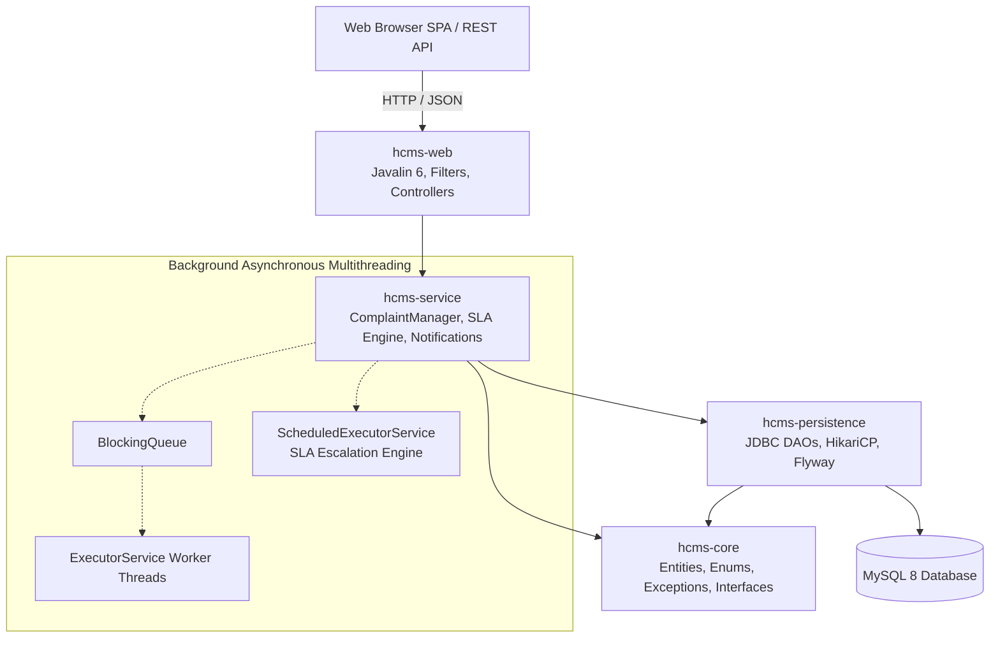
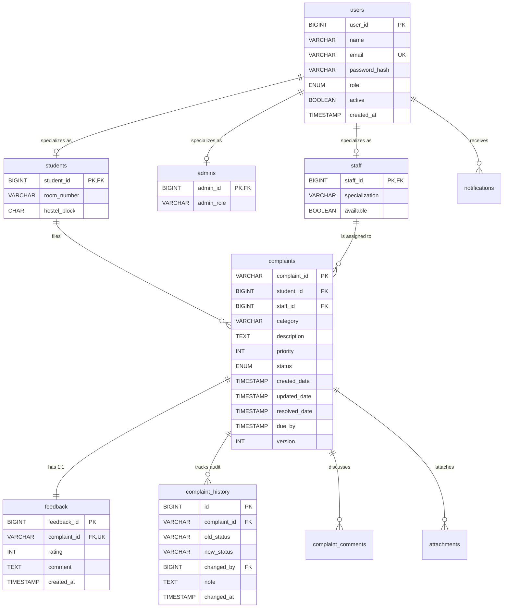
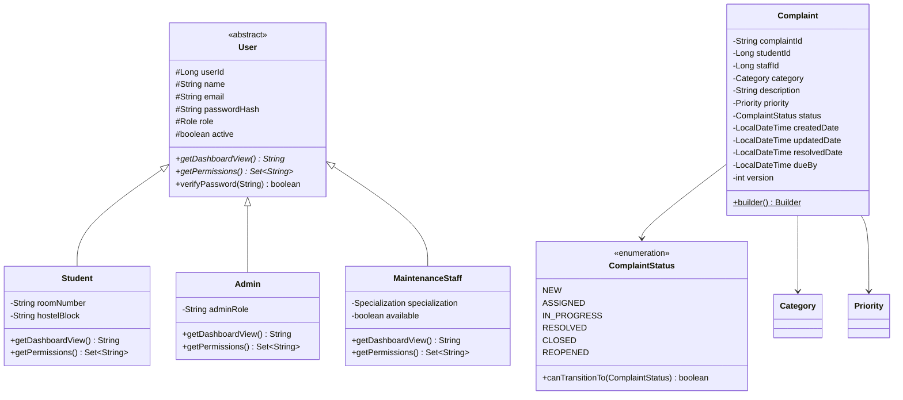
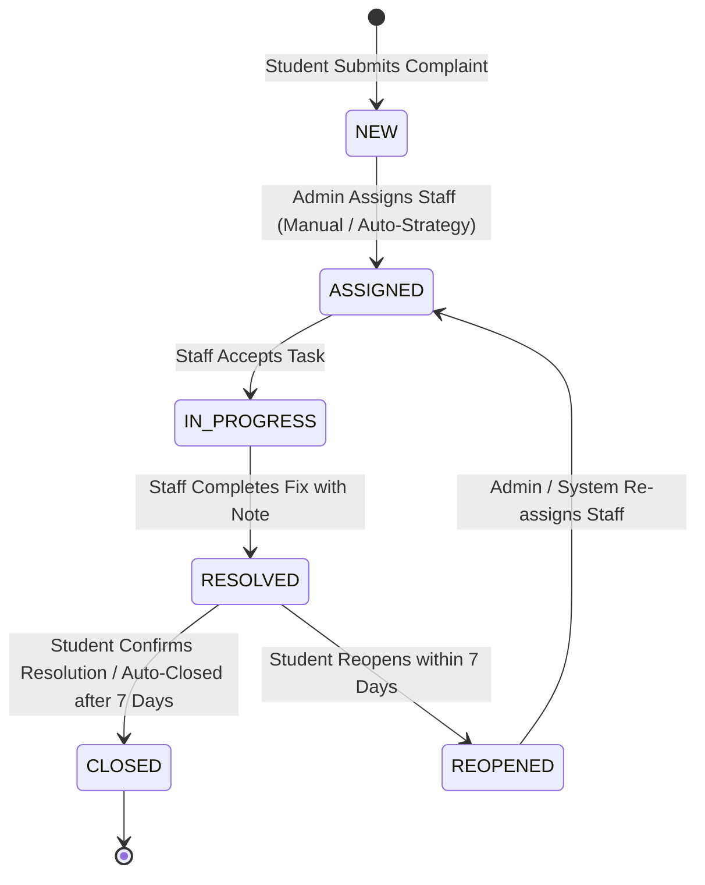

# Hostel Complaint & Maintenance System (HCMS)

**University Java Course Project — VIT Vellore**  
*A production-ready, multi-threaded, full-stack Java complaint lifecycle system built with modern Core Java, Javalin 6, HikariCP, MySQL 8, and a responsive Neo-brutalist Single Page Application.*

[](https://github.com/vit-vellore/hcms/actions)


---

## 1. Project Overview & Problem Statement

University hostel maintenance complaints (electrical sparking, ceiling fan failure, water leakage, Wi-Fi outage, AC breakdown, plumbing, carpentry) are traditionally logged on paper registers or scattered messaging channels. This causes:
- **No audit trail or accountability** for maintenance delays.
- **No urgency or priority handling** (critical short-circuits wait behind minor fixes).
- **No automated staff assignment** based on specialization or workload.
- **No transparent student tracking**, SLA breach warnings, or resolution feedback.

**HCMS (Hostel Complaint & Maintenance System)** digitizes this lifecycle completely:
1. **Student Reports**: Registers complaint with category, auto-priority elevation for hazard keywords, description, and optional photo.
2. **Admin Reviews & Assigns**: Triages queue ordered by priority and age, overrides priority, or executes **Intelligent Auto-Assign** using Strategy patterns.
3. **Staff Resolves**: Maintenance technician receives notifications, accepts tasks (`IN_PROGRESS`), and marks work `RESOLVED` with technician notes.
4. **Student Tracks & Closes**: Student tracks live history timeline, provides 1–5 star ratings with feedback, closes ticket, or reopens within 7 days.
5. **Background SLA Engine**: Automatically escalates priorities for overdue complaints and auto-closes resolved tickets past 7 days.

---

## 2. System Architecture & Module Structure

HCMS follows strict **Maven multi-module clean architecture** with one-way dependencies. Core domain logic has zero dependencies on web or persistence frameworks.

```
hcms-parent (Root POM: dependency management, plugin orchestration)
 ├── hcms-core         Domain models, enums, interfaces, exceptions, no framework/JDBC imports
 ├── hcms-persistence  JDBC DAOs, HikariCP pool, Flyway migrations (V1 schema, V2 seed)
 ├── hcms-service      ComplaintManager, state machine, SLA engine, strategies, notifications
 └── hcms-web          Javalin routes, controllers, auth filters, DTO records, static SPA, Main
```



---

## 3. Entity-Relationship (ER) Diagram



---

## 4. UML Class & Domain Diagram



---

## 5. Complaint State Machine Diagram



---

## 6. Java Course Concepts Demonstration Table

Every concept taught in the Advanced Java curriculum is purposefully integrated into the production architecture of HCMS:

| Course Concept | Applied Java Feature / Pattern | Exact Class & File Path | Purpose in HCMS |
| :--- | :--- | :--- | :--- |
| **OOP: Inheritance** | Direct 3-way subclassing | [`User.java`](file:///Users/ship/Desktop/Java%20Project/hcms-core/src/main/java/edu/vit/hcms/core/model/User.java)<br/>[`Student.java`](file:///Users/ship/Desktop/Java%20Project/hcms-core/src/main/java/edu/vit/hcms/core/model/Student.java)<br/>[`Admin.java`](file:///Users/ship/Desktop/Java%20Project/hcms-core/src/main/java/edu/vit/hcms/core/model/Admin.java)<br/>[`MaintenanceStaff.java`](file:///Users/ship/Desktop/Java%20Project/hcms-core/src/main/java/edu/vit/hcms/core/model/MaintenanceStaff.java) | Direct inheritance representing three distinct hostel roles without chained subclasses. |
| **OOP: Polymorphism** | Abstract method overriding & Dynamic Dispatch | `User.getDashboardView()`, `User.getPermissions()` | Provides role-specific views and dynamic permission sets for RBAC authorization. |
| **OOP: Encapsulation** | Private fields, Getters/Setters, Records | [`Complaint.java`](file:///Users/ship/Desktop/Java%20Project/hcms-core/src/main/java/edu/vit/hcms/core/model/Complaint.java)<br/>[`RegisterRequest.java`](file:///Users/ship/Desktop/Java%20Project/hcms-web/src/main/java/edu/vit/hcms/web/dto/RegisterRequest.java) | Prevents invalid field mutations; immutable record classes for clean HTTP DTO transport. |
| **OOP: Factory Pattern** | Centralized polymorphic instantiation | [`UserFactory.java`](file:///Users/ship/Desktop/Java%20Project/hcms-core/src/main/java/edu/vit/hcms/core/factory/UserFactory.java) | Instantiates correct `Student`, `Admin`, or `MaintenanceStaff` based on database role string. |
| **OOP: Strategy Pattern** | Interchangeable assignment algorithms | [`SpecializationMatchStrategy.java`](file:///Users/ship/Desktop/Java%20Project/hcms-service/src/main/java/edu/vit/hcms/service/strategy/SpecializationMatchStrategy.java)<br/>[`LeastWorkloadStrategy.java`](file:///Users/ship/Desktop/Java%20Project/hcms-service/src/main/java/edu/vit/hcms/service/strategy/LeastWorkloadStrategy.java) | Auto-assigns technician matching problem type and selects the staff member with least load. |
| **OOP: Observer Pattern** | Decoupled event listeners | [`ComplaintStatusListener.java`](file:///Users/ship/Desktop/Java%20Project/hcms-core/src/main/java/edu/vit/hcms/core/interfaces/ComplaintStatusListener.java)<br/>[`NotificationService.java`](file:///Users/ship/Desktop/Java%20Project/hcms-service/src/main/java/edu/vit/hcms/service/notification/NotificationService.java) | Listens for complaint state transitions and triggers asynchronous alerts and audit log entries. |
| **OOP: Singleton Pattern** | Thread-safe configuration holder | [`AppConfig.java`](file:///Users/ship/Desktop/Java%20Project/hcms-core/src/main/java/edu/vit/hcms/core/config/AppConfig.java) | Loads `.env` and environment variables once via double-checked locking singleton. |
| **OOP: Builder Pattern** | Validated fluent construction | [`Complaint.Builder`](file:///Users/ship/Desktop/Java%20Project/hcms-core/src/main/java/edu/vit/hcms/core/model/Complaint.java) | Enforces non-null validation on `studentId`, `category`, and `description` upon construction. |
| **Collections: PriorityQueue** | Heap ordering by Priority & CreatedDate | [`ComplaintManager.java`](file:///Users/ship/Desktop/Java%20Project/hcms-service/src/main/java/edu/vit/hcms/service/complaint/ComplaintManager.java) | Triage queue prioritizing `HIGH` priority tickets, broken by FIFO timestamp order. |
| **Collections: LinkedHashMap** | Bounded LRU Cache | [`ComplaintManager.java`](file:///Users/ship/Desktop/Java%20Project/hcms-service/src/main/java/edu/vit/hcms/service/complaint/ComplaintManager.java) | In-memory LRU complaint cache overriding `removeEldestEntry` in access-order mode. |
| **Collections: Deque** | Ring buffer activity feed | [`ComplaintManager.java`](file:///Users/ship/Desktop/Java%20Project/hcms-service/src/main/java/edu/vit/hcms/service/complaint/ComplaintManager.java) | Maintains the last 20 hostel maintenance activity logs for live ticker display. |
| **Collections: ConcurrentHashMap** | Thread-safe in-memory cache | [`RateLimitFilter.java`](file:///Users/ship/Desktop/Java%20Project/hcms-web/src/main/java/edu/vit/hcms/web/filter/RateLimitFilter.java) | Sliding-window per-IP rate limiting tracking timestamps without global lock contention. |
| **Collections: EnumMap** | High-performance array-backed map | [`AnalyticsService.java`](file:///Users/ship/Desktop/Java%20Project/hcms-service/src/main/java/edu/vit/hcms/service/analytics/AnalyticsService.java) | Stores complaint counts indexed by `ComplaintStatus` and `Category`. |
| **Collections: TreeMap** | Sorted Red-Black Tree | [`AnalyticsService.java`](file:///Users/ship/Desktop/Java%20Project/hcms-service/src/main/java/edu/vit/hcms/service/analytics/AnalyticsService.java) | Chronologically ordered 30-day time-series analytics of complaint registrations. |
| **Collections: Streams & Collectors** | Functional transformations | Throughout `AnalyticsService`, `AdminController` | Groups complaints by hostel block, calculates average resolution time, and generates CSV data. |
| **Exceptions: Hierarchy** | Checked and unchecked exception tree | [`HcmsException.java`](file:///Users/ship/Desktop/Java%20Project/hcms-core/src/main/java/edu/vit/hcms/core/exception/HcmsException.java)<br/>[`ValidationException.java`](file:///Users/ship/Desktop/Java%20Project/hcms-core/src/main/java/edu/vit/hcms/core/exception/ValidationException.java)<br/>[`InvalidStatusTransitionException.java`](file:///Users/ship/Desktop/Java%20Project/hcms-core/src/main/java/edu/vit/hcms/core/exception/InvalidStatusTransitionException.java) | Custom exception hierarchy mapped cleanly by `GlobalExceptionHandler` to JSON errors. |
| **Multithreading: Producer-Consumer** | BlockingQueue + Thread Pool | [`NotificationService.java`](file:///Users/ship/Desktop/Java%20Project/hcms-service/src/main/java/edu/vit/hcms/service/notification/NotificationService.java) | `BlockingQueue<NotificationTask>` with dedicated background worker thread pool. |
| **Multithreading: Scheduler** | Periodic background daemon | [`SlaEscalationEngine.java`](file:///Users/ship/Desktop/Java%20Project/hcms-service/src/main/java/edu/vit/hcms/service/engine/SlaEscalationEngine.java) | `ScheduledExecutorService` scanning overdue tickets every 15m and escalating priority. |
| **Multithreading: Concurrency Control** | AtomicLong + Optimistic Locking | [`ComplaintDao.java`](file:///Users/ship/Desktop/Java%20Project/hcms-persistence/src/main/java/edu/vit/hcms/persistence/dao/ComplaintDao.java) | `AtomicLong` for unique IDs; `version` column checks prevent double-assignment race conditions. |
| **Multithreading: Shutdown Hooks** | Graceful thread & pool draining | [`HcmsApplication.java`](file:///Users/ship/Desktop/Java%20Project/hcms-web/src/main/java/edu/vit/hcms/web/HcmsApplication.java) | `Runtime.getRuntime().addShutdownHook` ensures zero data loss upon application termination. |
| **JDBC: DAO & Connection Pool** | PreparedStatement + HikariCP | [`DatabaseManager.java`](file:///Users/ship/Desktop/Java%20Project/hcms-persistence/src/main/java/edu/vit/hcms/persistence/db/DatabaseManager.java)<br/>[`ComplaintDao.java`](file:///Users/ship/Desktop/Java%20Project/hcms-persistence/src/main/java/edu/vit/hcms/persistence/dao/ComplaintDao.java) | Connection pooling with tuned statement caches; 100% prepared statements; zero SQL injection. |
| **JDBC: Transaction Management** | Programmatic Commit & Rollback | [`TransactionManager.java`](file:///Users/ship/Desktop/Java%20Project/hcms-persistence/src/main/java/edu/vit/hcms/persistence/db/TransactionManager.java) | Thread-local connection binding guaranteeing atomic multi-step operations. |

---

## 7. Getting Started & Deployment

### Prerequisites
- **Java 17 or 21** (`java -version`)
- **Maven 3.8+** (`mvn -version`)
- **Docker & Docker Compose** (Optional for containerized run)
- **MySQL 8** (Included in Docker Compose)

---

### Option A: Running with Docker Compose (Recommended)

1. Clone or navigate to the project directory:
   ```bash
   cd "Java Project"
   ```
2. Start the entire system (MySQL 8 + HCMS Web Application):
   ```bash
   docker compose up --build
   ```
3. Open your browser:
   - **Frontend Application**: [http://localhost:8080](http://localhost:8080)
   - **Health Endpoint**: [http://localhost:8080/health](http://localhost:8080/health)
   - **Live Metrics**: [http://localhost:8080/metrics-lite](http://localhost:8080/metrics-lite)

---

### Option B: Running Locally (Manual / IDE)

1. Ensure MySQL 8 is running locally with database `hcms`:
   ```sql
   CREATE DATABASE hcms CHARACTER SET utf8mb4 COLLATE utf8mb4_unicode_ci;
   CREATE USER 'hcms'@'localhost' IDENTIFIED BY 'hcmspass';
   GRANT ALL PRIVILEGES ON hcms.* TO 'hcms'@'localhost';
   FLUSH PRIVILEGES;
   ```
2. Compile and package the fat JAR:
   ```bash
   mvn clean package -DskipTests
   ```
3. Run the shaded JAR:
   ```bash
   java -jar hcms-web/target/hcms-web-1.0.0.jar
   ```
   *Flyway automatically runs migrations `V1__create_schema.sql` and loads realistic demo data `V2__seed_data.sql` on startup!*

---

## 8. Default Demo Credentials

The database is pre-seeded with realistic data across all roles:

| Role | Name | Email | Password | Details |
| :--- | :--- | :--- | :--- | :--- |
| **Admin** | Dr. K. Ramanathan | `admin@vit.ac.in` | `admin123` | Chief Warden (Full administrative access, triage, auto-assign, analytics) |
| **Staff** | Murugan S. | `murugan.elec@vit.ac.in` | `staff123` | Specialization: `ELECTRICAL` (Available) |
| **Staff** | Palani K. | `palani.plumb@vit.ac.in` | `staff123` | Specialization: `PLUMBING` (Available) |
| **Staff** | Anand R. | `anand.wifi@vit.ac.in` | `staff123` | Specialization: `WIFI` (Available) |
| **Staff** | Saravanan M. | `saravanan.ac@vit.ac.in` | `staff123` | Specialization: `AC` (Available) |
| **Student** | Rohan Gupta | `rohan.g2023@vitstudent.ac.in` | `student123` | Room 301, Block A |
| **Student** | Priya Sharma | `priya.s2023@vitstudent.ac.in` | `student123` | Room 204, Block B |
| **Student** | Karthik V. | `karthik.v2024@vitstudent.ac.in` | `student123` | Room 112, Block C |

---

## 9. Frontend User Interface & Experience

The user interface is a zero-dependency **Single Page Application (SPA)** written in clean ES modules and vanilla CSS adhering to the slide deck's **Neo-brutalist aesthetic**:
- **Color Palette**: Cream background (`#F5F0E8`), Deep Navy (`#0B1F4A`), Cyan (`#00B4D8`), Teal (`#1B7A6B`), Amber (`#E8960C`), and Coral Red (`#D90429`).
- **Typography & Styling**: Bold geometric headers, monospace metadata labels, 2.5px solid black borders, and hard offset shadows (`4px 4px 0px #000000`).
- **Offline Charting**: Includes locally bundled, zero-CDN canvas charting (`chart.min.js`) for status distribution, category breakdown, and 30-day trends.
- **Built with Java Live Ticker**: Prominently displays JVM version, server uptime, active threads, and HikariCP connection pool health in real-time.

---

## 10. Automated Testing & Verification

Execute the automated test suite across all 5 modules:

```bash
# Run all unit tests
mvn test

# Run full verification including test coverage
mvn clean verify
```

### Test Coverage Highlights:
- **`ComplaintStatusTest`**: Validates the complete state machine transition matrix and rejection of illegal status skips.
- **`ComplaintIdGeneratorTest`**: Multi-threaded concurrency stress test verifying that `AtomicLong` and sequence counters produce 0 collision duplicates under high thread contention.
- **`ComplaintManagerTest`**: Verifies keyword priority auto-detection (`short circuit` -> `HIGH`), duplicate submission prevention within 10 minutes, `PriorityQueue` triage ordering, `LinkedHashMap` LRU cache hit/miss semantics, and `Deque` activity history bounds.
- **`StrategyTest`**: Validates `LeastWorkloadStrategy` and `SpecializationMatchStrategy`.
- **`SlaEscalationEngineTest`**: Tests automatic priority escalation for overdue tickets and auto-closing of resolved complaints.
- **`AuthFilterTest` & `RateLimitFilterTest`**: Tests JWT extraction, RBAC protection, and sliding window rate limiting.
- **`DaoIntegrationIT`**: MySQL 8 Testcontainer integration tests validating `UserDao`, `ComplaintDao`, and `SupportDao` against a real database.

---

## 11. Troubleshooting

| Issue | Cause | Resolution |
| :--- | :--- | :--- |
| **Connection Refused on Port 3306** | MySQL is still starting up in Docker. | The app includes automatic retry logic (`createWithRetry`) on startup. Wait 15–20 seconds for the MySQL healthcheck to pass. |
| **Port 8080 already in use** | Another service is listening on 8080. | Change `PORT=8081` in `.env` or run `PORT=8081 java -jar hcms-web/target/hcms-web-1.0.0.jar`. |
| **Docker not found on macOS** | Docker desktop is not running. | Run locally via `mvn clean package -DskipTests && java -jar hcms-web/target/hcms-web-1.0.0.jar`. |
| **Flyway Checksum Mismatch** | Migration SQL file edited after previous run. | Run `mvn flyway:repair` or delete the local docker volume: `docker compose down -v`. |

---

## 12. Documentation Index

- [REST API Reference](docs/API.md) — Comprehensive endpoint specifications, request/response bodies, and HTTP status codes.
- [Design & Architecture Document](docs/DESIGN.md) — Deep dive into OOP patterns, concurrency architecture, collections, and state machines.
